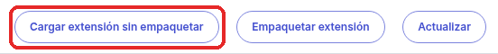
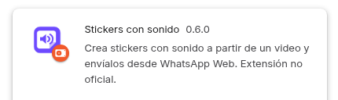

# Stickers con sonido

Extensión para Chrome, Edge o Brave que convierte un video en un **sticker con sonido** y lo envía desde **WhatsApp Web**. Todo se procesa en tu navegador: nada se sube a otro servidor que no sea WhatsApp.

> **Aviso:** proyecto personal, **no oficial**, sin relación con WhatsApp ni con Meta. Usa funciones internas de WhatsApp Web que pueden cambiar en cualquier momento, y activa en tu navegador la función de stickers con sonido, que WhatsApp está probando. Úsalo bajo tu propia responsabilidad.

## Instalación

No hay que ejecutar ningún programa: se carga la carpeta de la extensión en el navegador (Chrome, Edge o Brave de escritorio).

1. Descarga **`stickers-con-sonido-X.Y.Z.zip`** desde la [última versión](https://github.com/Shirtep/WA-audio-stickers/releases/latest).
2. Descomprímelo en un lugar donde se vaya a quedar, por ejemplo `Documentos`. Obtendrás una carpeta `stickers-con-sonido`.
   **No la borres ni la muevas después:** el navegador carga la extensión desde ahí.
3. Abre la página de extensiones: escribe `chrome://extensions` en la barra de direcciones (en Edge, `edge://extensions`).
4. Activa **Modo de desarrollador** (arriba a la derecha):

   

5. Pulsa **Cargar extensión sin empaquetar** (en algunas versiones se llama *Cargar descomprimida*):

   

6. Elige la carpeta `stickers-con-sonido` del paso 2 y pulsa **Seleccionar carpeta**. Aparecerá la extensión:

   

7. Pulsa el icono del rompecabezas de la barra del navegador y fija **Stickers con sonido** con la chincheta, para tener a mano su icono violeta.

Las capturas son de Brave. En Chrome y Edge se ve igual, con otros colores.

**Actualizar:** descarga el ZIP de la nueva versión y reemplaza el contenido de la carpeta `stickers-con-sonido` con el nuevo. Después pulsa el botón de recargar (↻) de la extensión en la página de extensiones. Tus ajustes se conservan.

**Desinstalar:** pulsa **Quitar** en la página de extensiones y borra la carpeta.

## Uso

1. Abre [web.whatsapp.com](https://web.whatsapp.com) y entra al chat donde quieres enviar el sticker.
2. Pulsa el icono violeta de la extensión. Se abre el panel con cuatro pasos:
   1. **Video:** elige un video con sonido.
   2. **Tramo:** arrastra las asas verdes para marcar el inicio y el fin. El video muestra el cuadro exacto, y **−/+** mueven un cuadro.
   3. **Formato:** pulsa **Calcular opciones**. Aparece una tabla de resolución × fps con el peso estimado de cada combinación:
      - verde: cabe;
      - amarillo: cabe bajando la calidad;
      - ✕: no cabe;
      - ★: la recomendada.
   4. **Crear y enviar:** opcionalmente escribe el **paquete** y el **autor** (WhatsApp los muestra bajo el sticker), crea el sticker, revisa la vista previa y envíalo.
3. Desde el celular puedes marcarlo como favorito para volver a usarlo.

## Límites

| | Límite | Motivo |
|---|---|---|
| Peso del sticker | **1 MB** | El servidor de WhatsApp rechaza archivos más grandes (error 413). |
| Peso del audio | 1 MB (≈ 10 min) | Límite de WhatsApp Web para el audio del sticker. |
| Resolución | 64 a 512 px | WhatsApp usa 512 px. Más grande no se ve mejor y pesa más. |
| Fluidez | hasta 30 fps | WhatsApp solo exige que cada cuadro dure al menos 8 ms. |

Cuanto más largo es el tramo, menos resolución o fps caben en 1 MB: la tabla del paso 3 muestra qué cabe antes de crear nada.

Quien recibe el sticker necesita una versión de WhatsApp que ya reproduzca stickers con sonido. Si no la tiene, verá un sticker normal, sin sonido.

## Privacidad

- La conversión del video ocurre en tu navegador.
- La extensión guarda un **registro de diagnóstico** solo en tu navegador, con los números de teléfono ocultos y sin claves. Puedes verlo, descargarlo o borrarlo desde *Herramientas de prueba* en el panel, o con clic derecho en el icono → *Opciones*.

## Requisitos

- Chrome, Edge o Brave de escritorio, actualizado (usa WebCodecs para codificar el audio).
- Una cuenta de WhatsApp abierta en WhatsApp Web.

## Para desarrolladores

- [`docs/como-funciona.md`](docs/como-funciona.md): cómo se arma un sticker con sonido (protobuf, formato del audio, límites) y cómo trabaja la extensión.
- [`dev/`](dev/): páginas para probar la conversión sin WhatsApp y el video de calibración de sincronía.
